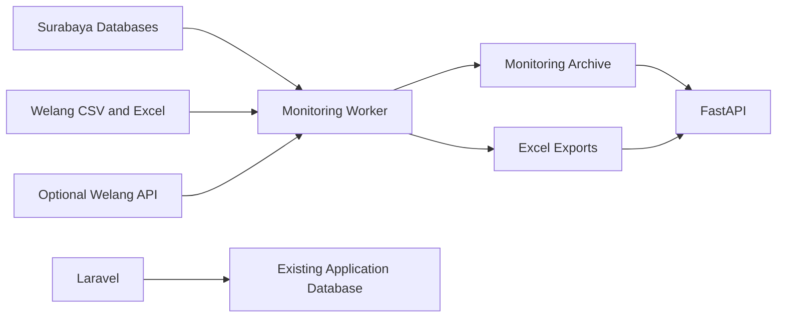

# Flood Forecasting Backend

Backend services for water-level monitoring, historical observations, and monthly data exports in the Welang River Basin and Surabaya.

## Monitoring terpusat dengan Supabase

Mode `supabase_compact` menyimpan agregat pengamatan, riwayat prediksi, dan evaluasi di PostgreSQL Supabase pada schema `ffws_monitoring`. MySQL tetap menjadi sumber sensor baca-saja; API/worker mode ini tidak memerlukan SQLite lokal. Data mentah Surabaya dibaca langsung dari MySQL untuk model dan Excel.

- [Panduan Supabase, konfigurasi, deployment, monitoring, dan backup](services/monitoring-api/README.central.md)
- [Prediksi internal dan evaluasi](services/monitoring-api/README.shadow.md)
- [Mode arsip monitoring lama](services/monitoring-api/README.monitoring.md)

Bagian arsip dan ekspor tahunan di bawah menjelaskan jalur lama; mode pusat memakai agregat 5 menit serta unduhan berdasarkan rentang tanggal. Backend dan worker tetap harus berjalan pada hosting agar proses tidak bergantung pada laptop.

## Overview

The backend combines the existing Laravel application with a separate FastAPI monitoring service. Laravel retains its authentication, station management, contacts, imports, and historical endpoints. FastAPI serves station observations from a persistent monitoring archive.

A background worker collects Surabaya telemetry, imports historical Welang datasets, and prepares Excel downloads. Prediction models and Telegram scheduling are disabled by default, so monitoring can run without model artifacts.

## Key Features

- Station snapshots and sensor history through REST APIs
- Read-only collection from four Surabaya sensor databases
- Historical Welang imports from CSV and Excel
- Persistent observations with source identity and original timestamps
- Monthly Excel exports covering 12 calendar months
- Existing Laravel routes and application data retained
- Optional prediction and notification integration

## Data Sources

| Data | Source | Usage |
|---|---|---|
| Surabaya telemetry | Four configured MySQL databases | Current observations and historical backfill |
| Welang observations | CSV and Excel in `imports/history/` | Historical monitoring records |
| Future Welang telemetry | Optional upstream API | Live observations using the monitoring API contract |

Surabaya collection uses read-only source accounts. Historical backfill runs in bounded batches; a complete year of source history is available only after backfill finishes.

The bundled Welang CSV files contain observations from 2022 and 2023. Original dates are preserved, and missing periods remain empty. The archive retains source records when an upstream connection is unavailable.

## System Architecture



The monitoring archive is separate from both the Laravel database and sensor databases. FastAPI handles observation queries and download requests; the worker handles ingestion, backfill, and export generation.

## Technology Stack

- Laravel 9 and PHP `^8.1`
- FastAPI and Python 3.12
- MySQL for application and archive storage
- SQLAlchemy and PyMySQL for monitoring persistence
- OpenPyXL and XlsxWriter for spreadsheet processing
- Docker Compose for the combined deployment

## Project Structure

```text
backend/
├── app/                        # Laravel application
├── config/                     # Laravel configuration and feature flags
├── database/                   # Laravel migrations and seeders
├── routes/                     # Existing application routes
├── infra/laravel/              # Laravel container setup
└── services/monitoring-api/
    ├── api/                    # Active FastAPI entrypoint
    ├── monitoring/             # Collection, queries, archive and exports
    ├── configs/surabaya/       # Source connections and sensor references
    ├── imports/history/        # Welang CSV and Excel inputs
    └── monitoring_tests/       # Archive integration tests
```

Run the monitoring service from `services/monitoring-api`. The root-level Python directories contain earlier prediction code and are not the active monitoring entrypoint.

## Local Development

### Laravel

Requirements: PHP compatible with `composer.json`, Composer, MySQL, and the PHP extensions required by the installed packages.

For a new local installation with an empty database:

```powershell
composer install
Copy-Item .env.example .env
```

Configure the local database in `.env`, then run:

```powershell
php artisan key:generate
php artisan jwt:secret
php artisan migrate
php artisan db:seed
php artisan serve
```

For an existing installation, preserve its `.env`, APP_KEY, JWT secret, database, and storage. Review migrations and seeders before applying them to existing data. Seeded water-level thresholds are placeholders and require domain validation before operational use.

### Monitoring API

The monitoring service requires a dedicated writable archive database and read-only source credentials. See the [monitoring guide](services/monitoring-api/README.monitoring.md) for initialization, source formats, API contracts, and model configuration.

Archive tests can be run from `services/monitoring-api` with a Python 3.12 virtual environment active:

```powershell
python -m pip install -r requirements-monitoring.txt
python -m pip install pytest httpx
python -m pytest monitoring_tests/test_archive.py
```

These tests use temporary SQLite databases and generated fixtures. The earlier prediction suite requires its own dependencies and compatible artifacts.

## Configuration

| Configuration | Purpose |
|---|---|
| Root `.env` | Existing Laravel application and database settings |
| `configs/surabaya/database.local.yaml` within the monitoring service | Private read-only source connections |
| `configs/surabaya/live_sources.yaml` within the monitoring service | Sensor definitions and water-level references |
| `ARCHIVE_DATABASE_URL` | Dedicated monitoring archive connection |
| `WELANG_IMPORT_PATH` | CSV/Excel directory or file inside the monitoring container |
| `WELANG_API_URL`, `WELANG_API_TOKEN` | Optional upstream Welang provider |
| `PREDICTIONS_ENABLED`, `TELEGRAM_ENABLED` | Optional features, both disabled by default |

Private credentials and model artifacts are excluded from version control. Enabling prediction requires compatible artifacts, prediction dependencies, and runtime configuration in addition to the feature flag.

Laravel scheduling is separate from the monitoring worker. When enabled, the Laravel scheduler runs `predict:everyonehour` and `polling:notificationtelegram`. Its prediction service URLs are configured through `DHOMPO_PREDICT_URL` and `DHOMPO_HEALTH_URL`.

## API Documentation

FastAPI exposes `/docs` and `/openapi.json` on its direct service address. Interactive documentation behind a stripped proxy prefix requires corresponding proxy/root-path configuration.

| Endpoint | Purpose |
|---|---|
| `GET /health/live` | Process health |
| `GET /health/ready` | Archive schema readiness |
| `GET /v1/stations?region=welang` | Regional station snapshots |
| `GET /v1/stations/{id}/history` | Sensor history, up to 31 days |
| `GET /surabaya/snapshot?include_history=false` | Lightweight Surabaya snapshot |
| `POST /v1/stations/{id}/exports` | Request an Excel export |
| `GET /v1/exports/{id}` | Export status |
| `GET /v1/exports/{id}/file` | Download a completed workbook |

Export sheets cover 12 calendar months ending at the latest observation month. Raw values, timestamps, units, and source identity are retained. Export files expire after 24 hours; observations are retained in the archive.

Existing Laravel routes are defined in `routes/api.php`. Historical references are available in the [Postman collection](https://documenter.getpostman.com/view/56404958/2sBY4Jw2uk) and [migration notes](MIGRATION_NOTICE.md).

## Related Repositories

- [FFWS Frontend](https://github.com/SomeRandomDolphin/ffws-frontend)
- [FFWS Backend](https://github.com/SomeRandomDolphin/ffws-backend)
- [FFWS Machine Learning](https://github.com/SomeRandomDolphin/ffws-ml)

## Funding and Affiliation

This project supports the Flood Forecasting Warning System initiative at the Department of Civil Engineering, Institut Teknologi Sepuluh Nopember (ITS).
