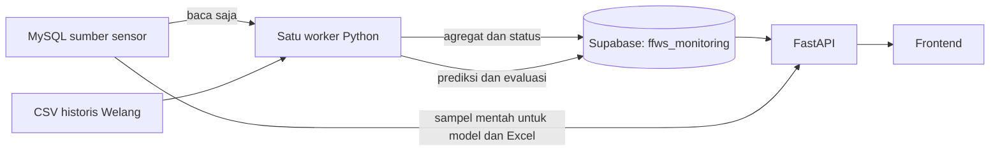

# Supabase: penyimpanan monitoring terpusat

Dokumen ini menjelaskan mode `supabase_compact`, yaitu backend monitoring yang tidak membutuhkan SQLite pada mesin aplikasi. Supabase dipakai sebagai PostgreSQL terpusat; MySQL sumber sensor tetap dibaca saja.

## Tujuan dan alur data

Sebelumnya backend menyalin pembacaan mentah ke SQLite lokal. File tersebut membesar dan perlu dipindahkan saat berganti mesin. Mode pusat menyimpan agregat yang ringkas dan riwayat prediksi di Supabase, sehingga mesin API/worker dapat diganti tanpa menyalin database lokal.



Supabase menyimpan data, bukan menjalankan worker Python. Hosting API dan worker tetap diperlukan agar proses berjalan saat laptop mati. Konfigurasi Docker tersedia, tetapi tidak otomatis men-deploy ke akun hosting baru.

## Apa yang disimpan

Semua tabel berada pada schema **`ffws_monitoring`**, bukan `public`. Di Supabase Table Editor, ubah dropdown schema untuk melihatnya.

| Tabel | Fungsi |
|---|---|
| `observations` | Agregat Surabaya 5 menit dan data historis Welang yang ukurannya kecil |
| `aggregate_stats` | Minimum, maksimum, jumlah sampel, jumlah nol/tidak valid, serta median valid sensor muka air |
| `source_state` | Checkpoint pengumpulan, waktu sinkronisasi, error sumber, dan heartbeat worker pusat |
| `import_batches` | Checksum serta hasil impor CSV/Excel agar impor ulang tidak menggandakan data |
| `shadow_runs` | Waktu acuan/penerbitan, input, versi model, dan alasan prediksi diterbitkan atau dilewati |
| `shadow_forecasts` | Prediksi operasional per model/horizon, aktual, status penilaian, dan error |
| `shadow_preview_history` | Snapshot prediksi berdasarkan data terakhir, termasuk replay historis |
| `export_jobs`, `export_cache` | Kompatibilitas mode arsip lama; cache ekspor tahunan tidak dijalankan pada mode pusat |

Tidak ada salinan penuh jutaan baris mentah Surabaya di cloud. File SQLite lama tidak dihapus dan tidak diperlukan oleh API/worker mode pusat. Dataset eksperimen offline juga tidak diunggah otomatis.

## Aturan pengamatan dan grafik

- Bootstrap mengambil tujuh hari sebelum bin lengkap terakhir setiap sumber. Sumber yang berhenti mengirim tetap dapat memiliki jendela historis terakhir.
- Sinkronisasi berikutnya memperbarui bucket yang bertumpang tindih; checkpoint `median-v2` mencegah format agregat lama tercampur.
- Retensi pengamatan Surabaya adalah 30 hari di belakang waktu bin terbaru **masing-masing sumber**, bukan otomatis 30 hari sebelum jam sekarang. Riwayat lama tetap berada di MySQL sumber.
- Data sensor muka air memakai median valid 5 menit dengan fungsi pemeriksaan kualitas yang sama seperti model. Diperlukan minimal lima timestamp unik per bin, tanpa sampel yang gagal pemeriksaan.
- Nol, negatif, di atas acuan, konflik duplikat, dan nilai positif menetap >=6 jam tidak menjadi input sehat. Deteksi beku bersifat kausal; pembacaan tidak diubah menjadi error secara retrospektif. Sinkronisasi membawa konteks 12 jam sebelum bucket yang diperbarui.
- Duplikat identik dihitung sekali. Minimum/maksimum sumber tetap disimpan. Jumlah `valid_samples` menunjukkan kelayakan rentang nilai; `median_distance` juga memperhitungkan kelengkapan dan deteksi beku.
- Parameter selain muka air tetap memakai rata-rata. CSV Welang bawaan tetap pada frekuensi sumbernya; file kecil ini tidak perlu dihilangkan.
- Grafik muka air mengembalikan `aggregationMethod=median_valid_5min`, `aggregationSeconds=300`, dan rentang minimum/maksimum dalam satuan terkalibrasi. Frontend tidak merata-ratakan median tersebut lagi. Bin tidak layak menjadi jeda, bukan nol atau interpolasi.
- Card terakhir memakai median mentah bin lengkap untuk status sensor; bin tidak layak tidak otomatis diartikan sebagai muka air penuh yang valid. Nilai nol tetap dapat digunakan UI untuk menandai sensor.
- Bin diberi waktu akhir: 12.05 mewakili sampel pada [12.00,12.05). Pembacaan card bisa tertinggal sekitar lima menit dari sensor. Timestamp disimpan sebagai UTC dan ditampilkan sebagai WIB.

## Prediksi, evaluasi, dan unduhan

`SHADOW_FORECAST_ENABLED=true` menjalankan persistensi dan tren teredam tau=1 jam. Ini terpisah dari flag `PREDICTIONS_ENABLED` untuk model artefak lama. Kalibokor belum diaktifkan karena data evaluasi terbatas.

Worker menerbitkan prediksi +1..+5 jam pada sepuluh menit pertama tiap jam, menggunakan 72 bin riwayat 6 jam yang lengkap. Input dan aktual penilaian dibaca dari MySQL mentah dengan pemeriksaan kualitas, bukan diperkirakan dari rata-rata cloud. Nilai input disimpan untuk audit. Tidak ada penerbitan ulang jam yang terlewat saat worker mati.

Penilaian dimulai sepuluh menit setelah target, lalu mencoba kembali sampai 24 jam. Target tanpa aktual valid menjadi `unavailable`. Aktual valid pertama dikunci; koreksi sumber berikutnya tidak menimpa hasil evaluasi. Laporkan cakupan `issued/scored/pending/unavailable`, bukan hanya error. Native MySQL tidak menyediakan waktu kedatangan asli; simulasi tidak dapat merekonstruksi keterlambatan pengiriman masa lalu secara sempurna.

Drawer menghitung prediksi dari enam jam sebelum bin lengkap terakhir yang tersedia. Jika waktunya sudah lewat, ini replay historis. Snapshot dideduplikasi berdasarkan sumber input, waktu acuan, sensor, acuan kalibrasi, dan versi model. Replay disimpan terpisah dan **tidak masuk skor prediksi operasional**. Membuka preview berulang tidak menggandakan snapshot identik.

Excel rentang tanggal berisi `Data pengamatan` (mentah dari MySQL) dan `Prediksi` (riwayat Supabase). Filter tanggal prediksi mengikuti waktu target, bukan waktu perhitungan. Model, jenis replay/operasional, waktu acuan, waktu perhitungan, versi, ID, dan status evaluasi disertakan. File Excel sementara dihapus setelah respons unduhan; tidak perlu volume file lintas mesin. Endpoint ekspor tahunan lama mengembalikan 409 pada mode pusat.

Jika MySQL tidak terhubung, grafik agregat dan riwayat cloud tetap bisa dibaca. Perhitungan prediksi baru dan unduhan mentah bergantung pada akses sumber sehingga bisa sementara tidak tersedia.

## Konfigurasi dan menjalankan

Jalankan dari direktori `services/monitoring-api`.

1. Pasang `requirements-monitoring.txt` pada environment Python backend. Untuk environment proyek Windows yang dikelola uv:
   ```powershell
   uv pip install --python ../../.venv/Scripts/python.exe -r requirements-monitoring.txt
   ```
2. Salin `.env.supabase.example` menjadi `.env.supabase.local`. Isi parameter Supabase Session Pooler dan MySQL sumber. File lokal sudah diabaikan Git serta Docker build.
3. Atur `MONITORING_STORAGE=supabase_compact` dan `SHADOW_FORECAST_ENABLED=true`. Driver PostgreSQL memakai psycopg, koneksi TLS wajib. Session Pooler port 5432 digunakan karena worker memegang session advisory lock; jangan menggantinya dengan transaction pooling tanpa mengubah mekanisme lock.
4. Inisialisasi dan isi data awal:
   ```powershell
   $env:MONITORING_STORAGE='supabase_compact'
   ../../.venv/Scripts/python.exe -m monitoring.worker init
   ../../.venv/Scripts/python.exe -m monitoring.cloud_setup bootstrap
   ../../.venv/Scripts/python.exe -m monitoring.cloud_setup verify
   ```
5. Jalankan dua terminal:
   ```powershell
   ./scripts/run-central.ps1 -Role api
   ./scripts/run-central.ps1 -Role worker
   ```

| Pengaturan | Keterangan |
|---|---|
| `MONITORING_STORAGE` | `supabase_compact` memilih penyimpanan pusat; tidak disetel berarti mode arsip lama |
| `SHADOW_FORECAST_ENABLED` | Mengaktifkan penerbitan/evaluasi dan endpoint prakiraan eksperimental |
| `SUPABASE_DB_HOST/PORT/NAME/USER/PASSWORD` | Kredensial database, hanya backend; template port 5432 dan database postgres |
| `MONITORING_SUPABASE_CONFIG` | Lokasi alternatif file secret; default `.env.supabase.local` pada direktori kerja |
| `MYSQL_SOURCE_HOST/PORT/USER/PASSWORD` | Akses baca MySQL sumber melalui secret environment/file lokal |
| `SURABAYA_DATABASE_CONFIG` | YAML lokal sebagai fallback jika host MySQL tidak disediakan melalui environment |
| `EXPORT_DIR` | Direktori file unduhan sementara; launcher pusat memakai folder temporer |
| `WELANG_IMPORT_PATH` | Folder historis Welang; launcher mengarah ke `imports/history` |

Nilai process environment mengalahkan file konfigurasi. Jangan menaruh password pada frontend, variabel `NEXT_PUBLIC_*`, Git, atau log. Schema aplikasi dicabut aksesnya dari `PUBLIC`, `anon`, dan `authenticated`; backend tersambung langsung memakai kredensial database. API monitoring belum memiliki autentikasi sendiri: lindungi dengan gateway sebelum dibuka ke internet.

### Docker/hosting

```sh
docker compose -f docker-compose.central.yml up -d --build
```

Konfigurasi menyediakan API dan satu worker, tanpa volume SQLite. Masukkan kredensial melalui secret/environment hosting; file YAML MySQL tidak wajib. Port API contoh hanya terikat ke loopback. PostgreSQL advisory lock mencegah dua worker pusat berjalan sekaligus. Data cloud tetap ada setelah container dihapus, tetapi file unduhan sementara tidak dipertahankan.

## Migrasi dan rollback

Untuk membawa prediksi dari instalasi SQLite sebelumnya:

```powershell
../../.venv/Scripts/python.exe -m monitoring.cloud_setup migrate-predictions --sqlite PATH_TO_OLD_SQLITE
```

Hanya tiga tabel `shadow_*` yang disalin. Verifikasi membandingkan ID, waktu dan metadata; toleransi angka floating-point adalah 1e-9 cm. Operasi idempoten, tidak menghapus sumber. Catatan ekspor yang menunjuk file lokal tidak dimigrasikan. Checkpoint pengumpulan cloud dibuat ulang untuk agregasi, bukan mewarisi cursor arsip mentah.

Rollback: hentikan API dan worker pusat, hapus flag `MONITORING_STORAGE`, isi `ARCHIVE_DATABASE_URL` dengan SQLite lama, lalu jalankan mode arsip. Prediksi yang tercipta setelah perpindahan tidak otomatis masuk kembali ke SQLite; ekspor/backup terlebih dahulu jika diperlukan.

## Monitoring, kapasitas, dan backup

| Endpoint/perintah | Fungsi |
|---|---|
| `GET /health` | Kesiapan database dan mode penyimpanan aktif |
| `GET /v1/storage/status` | Ukuran database aktual, retensi, status sumber, waktu sinkronisasi dan heartbeat worker |
| `GET /v1/shadow/metrics` | Jumlah penerbitan/penilaian, MAE/RMSE/bias per sensor/model/horizon, dan indikator sampel terbatas |
| `cloud_setup verify` | Jumlah baris tabel utama serta ukuran database |

Pantau quota proyek Supabase, terutama sebelum menambah sensor atau retensi. Agregasi dan retensi bukan jaminan kapasitas tidak terbatas; update PostgreSQL dan indeks juga membutuhkan ruang. Riwayat prediksi belum dihapus otomatis. Estimasi sekitar 80 MB saat bootstrap awal bukan ukuran untuk seluruh arsip historis.

Backup schema `ffws_monitoring` (struktur dan data) secara terjadwal ke penyimpanan terpisah, misalnya memakai pg_dump melalui koneksi PostgreSQL yang sesuai. Jangan menganggap push kode sebagai backup database. Pastikan backup dapat direstore pada database uji dan bandingkan jumlah/isi tabel, termasuk relasi run-prediksi. Jadwal dan tempat backup eksternal belum diprovisikan oleh konfigurasi ini.

## Pengujian

```sh
python -m pytest monitoring_tests -q
```

Pengujian mencakup kalibrasi/arsip lama, agregasi dan ekstrem, median grafik versus model, data beku kausal, snapshot batch, deduplikasi prediksi, penilaian aktual, dan ekspor berdasarkan tanggal. Koneksi Supabase, ukuran, izin schema, single-worker lock, serta alur Excel juga perlu diverifikasi saat pindah proyek/hosting.
